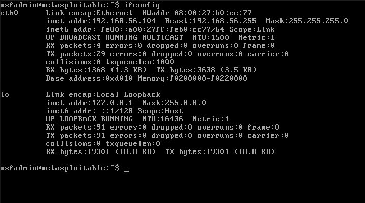

# Projeto Prático: Simulação de Ataques de Força Bruta com Kali Linux e Medusa

Documentação de projeto desenvolvida no âmbito do **Bootcamp Santander de Cibersegurança** da **DIO (Digital Innovation One)**. Este laboratório tem como propósito aprofundar os conhecimentos práticos em testes de intrusão (Pentest) em ambiente controlado, abordando simulações de ataques de força bruta, análise de vulnerabilidades e diretrizes essenciais de mitigação.

---

## 🛠️ 1. Configuração e Arquitetura do Laboratório

O ambiente foi estruturado com o auxílio do **VirtualBox**, empregando duas máquinas virtuais isoladas por meio de uma rede interna (Host-Only). Essa topologia assegura a estabilidade e o isolamento necessários para a execução segura dos testes.

* **Estação Atacante (Kali Linux):**
  * **Endereço IP:** `192.168.56.102`
  * **Finalidade:** Central de comando para o escaneamento de portas e execução das ferramentas de força bruta.

* **Estação Alvo (Metasploitable 2):**
  * **Endereço IP:** `192.168.56.104`
  * **Finalidade:** Servidor propositalmente vulnerável, configurado para hospedar múltiplos serviços legados (como FTP, SSH e SMB).

* **Validação de Conectividade:** A comunicação entre os nós foi validada através de disparos de pacotes ICMP (`ping`) a partir do Kali Linux, atestando a integridade da rede interna com 0% de perda de pacotes.

---

## 🚀 2. Próximos Passos e Evolução do Projeto
* Execução de varreduras e testes de força bruta direcionados aos serviços expostos utilizando o **Medusa**.
* Documentação técnica dos resultados obtidos e elaboração de planos de ação para a remediação das falhas identificadas.

---

## 👨‍💻 Autoria
Desenvolvida por **Joyce Paz** durante a jornada de capacitação técnica do Bootcamp Santander Cibersegurança na [DIO](https://www.dio.me/).
